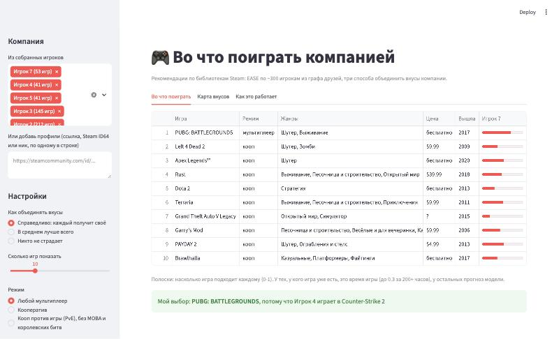
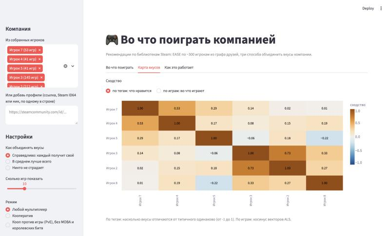

# Steam Group Recs: сбор данных

Шаг 1 пет проекта «во что поиграть компанией». Скрипт обходит граф друзей Steam
(вы и ваша компания, их друзья, друзья друзей), собирает библиотеки и время игры,
а затем метаданные игр: жанры, категории магазина, признаки co-op и multiplayer,
пользовательские теги. Результат лежит в parquet и готов для ALS и эмбеддингов.

## Запуск на MacBook (M1/M2/M3)

```bash
cd steam-group-recs
python3 -m venv .venv && source .venv/bin/activate
pip install -r requirements.txt

cp .env.example .env        # и вставьте STEAM_API_KEY
python -m pytest            # тесты на фейковом Steam, сеть не нужна
```

Ключ берётся бесплатно на https://steamcommunity.com/dev/apikey и читается только
из `.env` или переменной окружения `STEAM_API_KEY`. `.env` и `data/` в `.gitignore`.

Пробный маленький запуск (несколько минут):

```bash
python -m steamrec collect \
  --seed https://steamcommunity.com/id/<ваш_vanity> \
  --seed 7656119XXXXXXXXXX --seed <ник_друга> \
  --depth 1 --max-users 50 --max-apps 200
```

Полный запуск для обучения:

```bash
python -m steamrec collect --seed <вы> --seed <друг1> --seed <друг2> \
  --depth 2 --max-friends 30 --max-users 500
```

`--seed` указывайте для каждого человека из компании: их игры всегда попадут в
выборку, а в `users.parquet` они помечены `is_seed=True`. Принимаются Steam ID64,
ссылка на профиль или vanity имя.

Прерывать можно в любой момент: все ответы кешируются в `data/raw/cache.sqlite`,
повторный запуск продолжит с того же места и не потратит лимиты. Если библиотеки уже
собраны, догрузить или расширить игры можно отдельно: `python -m steamrec games --min-owners 3`.

### Сколько это занимает

| Этап | Лимит | Порядок времени |
|---|---|---|
| Профили, друзья, библиотеки (Web API) | пауза 0.25 с, около 100k запросов в сутки | 500 человек: 5-10 минут |
| Карточки игр (Store API) | около 200 запросов за 5 минут, пауза 1.6 с | 2000 игр: около часа |
| Теги (SteamSpy) | 1 запрос в секунду | плюс около 40 минут на 2000 игр |

Самый долгий этап это игры. Чтобы ускорить: `--min-owners 3`, `--max-apps 1500`
или `--no-tags`. Store API на перегрузку отвечает 429, скрипт ждёт и повторяет сам.

### Основные параметры

| Параметр | По умолчанию | Смысл |
|---|---|---|
| `--depth` | 2 | 0 только seed, 1 плюс друзья, 2 плюс друзья друзей |
| `--max-friends` | 30 | сколько друзей брать у каждого начиная с глубины 1 (случайная выборка, seed=42); друзья seed берутся все |
| `--max-users` | 500 | сколько открытых профилей обойти всего |
| `--min-owners` | 2 | брать карточки игр, которые есть хотя бы у N человек; игры компании берутся всегда |
| `--max-apps` | нет | потолок числа игр |
| `--no-tags` | выкл | не ходить в SteamSpy |
| `--anonymize` | выкл | заменить Steam ID на sha256 с солью `STEAM_ID_SALT` и убрать ники |

## Что получается

Всё в `data/processed/`:

| Файл | Строка | Колонки |
|---|---|---|
| `users.parquet` | пользователь | `steamid, depth, is_seed, is_public, crawled, library_public, friends_public, personaname, country, time_created` |
| `friendships.parquet` | ребро дружбы | `src, dst, friend_since` (dst может быть закрытым или не обойдённым профилем) |
| `interactions.parquet` | пара пользователь-игра | `steamid, appid, playtime_forever, playtime_2weeks, rtime_last_played` (время в минутах) |
| `games.parquet` | игра | `appid, name, type, is_free, genres, categories, is_singleplayer, is_multiplayer, is_coop, is_online_coop, is_local_coop, is_pvp, remote_play_together, crossplay, price_usd, metacritic, release_date, platforms, developers, publishers, short_description, recommendations, in_store` |
| `game_tags.parquet` | тег игры | `appid, tag, votes` |
| `game_stats_steamspy.parquet` | игра | `appid, owners_range, positive, negative, median_forever, ccu` |
| `library_apps.parquet` | игра | `appid, name` из библиотек, запасной источник названий |

`interactions` это неявный фидбек для ALS, `games` и `game_tags` дают признаки для
контентной части и фильтр кооператива на шаге групповых рекомендаций.

Флаги co-op считаются по ID категорий магазина (`steamrec/games.py`): `is_coop` это
Co-op, Online Co-op, Shared/Split Screen Co-op или LAN Co-op; `remote_play_together`
полезен отдельно, потому что так играть можно с одной копией игры на компанию.

## Шаг 2: профили вкуса

```bash
python -m steamrec train                          # метрики, обучение, data/model/taste.npz
python -m steamrec taste                          # карта вкусов компании (seed из сбора)
python -m steamrec taste --user ник1 --user ник2  # или любая группа
python -m steamrec recs --user <ник> --multiplayer
python -m steamrec similar --game "PEAK"
```

Что внутри (`steamrec/model.py`):

- **Подготовка.** Убираем не игры (тестовые серверы, демо, моды), игры с одним владельцем
  и библиотеки меньше 5 игр. Владение это предпочтение, время игры задаёт уверенность
  `c = 1 + alpha * log1p(часы)`: купленная и не запущенная игра остаётся слабым сигналом.
- **ALS** (Hu, Koren, Volinsky, 2008), написан на numpy: вектор вкуса у каждого игрока и игры.
  Из них карта сходства «кто играет в одно и то же» и похожие игры по игрокам.
- **EASE** (Steck, 2019): линейная модель «игра из игр» в закрытой форме. На ~300
  библиотеках точнее ALS, поэтому оценки для рекомендаций берём из неё. Работает и для
  игрока, которого не было в обучении: нужна только его библиотека.
- **Векторы по тегам.** TF-IDF по тегам SteamSpy (вес голосов), жанрам и значимым
  категориям, сжатый SVD до 64. Профиль игрока это среднее векторов его игр с весом времени
  минус средний профиль выборки, чтобы сходство показывало, чем вкус отличается от
  типичного «все любят шутеры». Работает и при скрытом времени игры.

Проверка: у каждого с 10+ играми прячем 20% библиотеки и смотрим, найдёт ли модель в
топ-20 игры, в которые человек реально играл 2+ часа. Полный сбор от 2026-10-17
(272 игрока, 2827 игр):

| Модель | recall@20 | ndcg@20 |
|---|---|---|
| EASE, lambda=200 | 0.343 | 0.312 |
| ALS, 64 фактора, reg=10, alpha=1 | 0.317 | 0.275 |
| Советовать популярное | 0.274 | 0.257 |

Параметры подобраны по сетке (factors 16-128, reg 0.1-100, alpha 0-5). Выше alpha
уверенность от времени игры начинает мешать: на этих данных факт владения важнее часов.

## Шаг 3: во что поиграть компанией

```bash
python -m steamrec group                              # компания = seed из сбора, стратегия fair
python -m steamrec group --user ник1 --user ник2 --user ник3
python -m steamrec group --strategy all -n 8          # сравнить три стратегии
python -m steamrec group --fresh                       # ни у кого нет и вышли за последний год
python -m steamrec group --genre Хоррор --genre Выживание   # жанры, подойдёт любой
python -m steamrec group --pve --since 2023             # кооп против игры, вышли с 2023
python -m steamrec group --new-only --max-price 15     # незнакомое компании, до $15
python -m steamrec group --eval                       # проверка на случайных компаниях
```

Как считается (`steamrec/group.py`):

1. **Кандидаты:** кооп и мультиплеерные игры из модели. То, что есть у всех, не
   предлагаем: компания и так об этом знает. Флаг Co-op из магазина ненадёжен (Dota 2
   кооп против ботов, Apex кооп отрядом), поэтому `--pve` дополнительно убирает игры,
   где соревнование игроков в основе: теги MOBA, Battle Royale, Competitive, Hero Shooter,
   Fighting и т.п. среди первых 10, тег PvP высоко без PvE, MMO с PvP без PvE. Это эвристика.
   `--genre` ищет жанр среди первых 7 тегов SteamSpy по голосам и в жанрах магазина
   (список в `GENRES` в `steamrec/group.py`).
   `--since` фильтрует по году выхода из магазина (у игр из раннего доступа это дата 1.0).
2. **Польза для каждого участника** от 0 до 1. Игры, которых у него нет: оценка EASE
   по его библиотеке, делённая на его максимум, чтобы большие библиотеки не перевешивали.
   Игры, которые уже есть: по времени игры, log-шкала до 200 часов, не выше 0.3, иначе
   список забивается тем, во что компания и так играет.
3. **Объединение:**
   - `mean`: среднее, «в среднем всем нормально»;
   - `misery`: минимум, «никто не страдает»;
   - `fair`: список собирается жадно, каждая следующая игра максимизирует
     сумму log(1 + накопленная польза) по участникам (пропорциональная справедливость):
     если первые игры больше нравятся одним, следующие подтянут остальных.
4. **Для каждой игры:** у кого уже есть, сколько стоит докупить остальным и почему
   подходит: игра из библиотеки участника с наибольшим весом EASE, с поправкой на
   популярность, чтобы объяснение не сводилось к «потому что все играют в CS2».

Проверка: компания = человек и трое его друзей с библиотеками, у каждого спрятано 20%
игр. Попадание = в общий топ-10 попала мультиплеерная игра, в которую он играл 2+ часа.
300 компаний на каждое из 5 разбиений:

| Стратегия | Попадание у участника | Попадание у всех четверых | Популярность игр в топе |
|---|---|---|---|
| fair | 0.644 | 0.186 | 0.366 |
| mean | 0.637 | 0.177 | 0.368 |
| misery | 0.571 | 0.145 | 0.310 |
| популярное | 0.611 | 0.171 | 0.408 |

Честный вывод: у компаний друзей вкусы и так похожи, поэтому топ популярного уже сильный
ориентир. `fair` обходит его ненамного по попаданиям, но советует менее очевидные игры.
`misery` на таких данных проигрывает: ищет то, что никому не противно, и упускает то,
что кому-то очень нравится. Разброс между разбиениями заметный, нужно больше данных.

## Шаг 4: веб страница

```bash
streamlit run app.py        # откроется http://localhost:8501
```

Слева выбираешь компанию из собранных игроков или вставляешь ссылки на любые профили:
их библиотеки подгрузятся через Steam API по ключу из `.env` (закрытые профили страница
покажет предупреждением). Дальше стратегия, число игр и фильтры: только кооп, только
новое, потолок цены. На вкладке «Во что поиграть» таблица с полосками пользы для каждого,
у кого игра уже есть, сколько стоит докупить, почему подходит и ссылка в магазин.
«Карта вкусов» показывает, кто на кого похож. Модель берётся из `data/model/taste.npz`,
после нового сбора её надо переобучить: `python -m steamrec train`.

Скриншоты сняты с `STEAMREC_ANON=1 streamlit run app.py`: ники заменены на «Игрок N».




## Ограничения, о которых стоит знать

- Видны только открытые профили. Закрытые попадают в `users` с `is_public=False`,
  но без библиотеки. Это смещение выборки: игроки с открытыми профилями чуть активнее.
- `playtime_forever` у части игр 0: игра куплена, но не запускалась. Для ALS это
  тоже сигнал, но слабее; решим на шаге 2.
- Store API отдаёт цены и названия для региона `cc=us`, удалённые из магазина игры
  попадают в `games` с `in_store=False` и только названием.
- Данные чужих профилей храните локально и не публикуйте сырыми. Для публичного
  репозитория или демо используйте `--anonymize`.

## Устройство кода

```
app.py        веб страница на Streamlit (шаг 4)
steamrec/
  http.py     лимиты по хосту, повторы с backoff, кеш SQLite (ключ API в кеш не попадает)
  api.py      Steam Web API, Store API, SteamSpy
  crawl.py    обход графа друзей в ширину с ограничениями
  games.py    разбор карточек игр и флаги co-op/multiplayer
  storage.py  таблицы, parquet, анонимизация, выбор игр для запроса
  model.py    шаг 2: ALS, EASE, векторы по тегам, оценка
  group.py    шаг 3: польза участников, стратегии mean/misery/fair, объяснения, оценка
  profiles.py команды train, taste, recs, similar, group
  cli.py      командная строка
tests/        фейковый Steam: обход, приватность, лимиты, 429, кеш, весь CLI
```
